# Post-contenido U9 - Entrada y Salida Avanzados (Puertos, Polling e Interrupciones en NASM sobre DOSBox)

Arquitectura de Computadores, Unidad 9, UFPS (ac09post01). Repositorio único para las dos partes del laboratorio.

## Objetivo y prerrequisitos

El estudiante implementa, en ensamblador x86 de 16 bits (NASM sobre DOSBox), el acceso directo a puertos de E/S con `IN` y `OUT`, la técnica de polling, la combinación de banderas de dos puertos de estado, y una Rutina de Servicio de Interrupción (ISR) para IRQ1 con programación del PIC 8259A.

- Software: DOSBox 0.74-3 y NASM 2.15.05 accesible desde el prompt de DOS.
- Conocimientos previos: INT 21h, registros de segmento, modos de direccionamiento (Unidades 3 a 6), IVT y flag IF.
- Todos los programas son `.COM` (`[ORG 0x100]`) y se ensamblan con `nasm -f bin`.

| Parte | Fuente | Binario | Qué demuestra |
|---|---|---|---|
| 1 | `TECL.ASM` | `TECL.COM` | Polling sin límite del 8042 (puertos 60h/64h) |
| 1 | `POLL_T.ASM` | `POLL_T.COM` | Polling con timeout configurable (`MAX_RETRY`) |
| 1 | `LPT_1.ASM` | `LPT_1.COM` | Escritura al puerto paralelo LPT1 (0378h-037Ah) |
| 1 | `MULTI_ST.ASM` | `MULTI_ST.COM` | Polling combinado con OR de dos puertos de estado |
| 2 | `ISR_KB.ASM` | `ISR_KB.COM` | ISR propio para IRQ1 (INT 09h) con restauración del vector |
| 2 | `MASK_KB.ASM` | `MASK_KB.COM` | Enmascarar/desenmascarar IRQ1 con el IMR (puerto 21h) |
| 2 | `ISR_CHAIN.ASM` | `ISR_CHAIN.COM` | Encadenamiento con el handler original (PUSHF + far CALL) |
| 2 | `ISR_TIME.ASM` | `ISR_TIME.COM` | Intervalo entre interrupciones con el contador en 0040h:006Ch |

### Nota sobre nombres de archivo

`LPT1` es un nombre de dispositivo reservado en DOS y en Windows (con o sin extensión), por lo que un archivo llamado `LPT1.ASM` ni siquiera puede crearse en Windows ni abrirse en DOSBox (el sistema lo interpreta como la impresora). Por eso el programa de la Parte 1 se llama `LPT_1.ASM` / `LPT_1.COM`. Además, `ISR_CHAIN.ASM` supera los 8 caracteres del formato 8.3 de DOSBox 0.74, que lo muestra como `ISR_CH~1.ASM`; el estudiante lo ensambla con ese nombre corto hacia `ISR_CHAI.COM` (mismo binario que `ISR_CHAIN.COM`).

### Ajustes respecto al código base de la guía

El estudiante corrigió cinco puntos del código de la guía para que ensamble y se ejecute correctamente:

1. Los puertos mayores a 0FFh (0378h-037Ah) se acceden con `DX` (`MOV DX, puerto` / `IN AL, DX`); `IN AL, 0379h` con inmediato trunca el puerto a 79h y NASM solo avisa con un warning.
2. Después de `LDS DX, [old_isr]` el registro DS quedaba apuntando al segmento del handler original; ahora se conserva con `PUSH DS` / `POP DS` antes de imprimir el mensaje final.
3. En `MASK_KB.ASM` las cadenas estaban antes de `start`, de modo que el `.COM` ejecutaba texto como código; ahora van al final. La espera usa resta modular de ticks y `JB` (sin signo).
4. En `TECL.ASM`, `POLL_T.ASM` y `MULTI_ST.ASM` el polling del teclado se hace con `CLI` y se rehabilitan las interrupciones con `STI` al terminar la espera: con IF=1 el handler BIOS de INT 09h lee el puerto 60h apenas llega la tecla y el bucle nunca llega a ver OBF=1 (el programa quedaba esperando para siempre).
5. Cada tecla genera dos interrupciones (make al presionar, break al soltar). Los ISR y `TECL.ASM` ignoran los break codes (bit 7 del scancode en 1) para contar pulsaciones reales; el EOI se envía igualmente en todos los casos.

## Parte 1 - Acceso directo a puertos de E/S

### Registros del 8042 (teclado)

- Puerto 60h, Data Port: guarda el último scancode o byte de respuesta.
- Puerto 64h, Status Register: el bit 0 (OBF, Output Buffer Full) en 1 indica que hay un dato listo para leer en el 60h.

### Registros del puerto paralelo LPT1

- 0378h, Data Register: 8 bits de datos hacia las líneas D0-D7.
- 0379h, Status Register: retroalimentación del periférico (BUSY#, ACK, PE, SELECT, ERROR); el bit 7 es BUSY#.
- 037Ah, Control Register: STROBE (bit 0), AUTOFEED, INIT y SELECT_IN.

Protocolo centronics implementado en `LPT_1.ASM`: (1) esperar BUSY#=1, (2) colocar el dato en 0378h, (3) activar STROBE (bit 0 del control) durante un retardo corto, (4) desactivar STROBE. En DOSBox no hay impresora conectada, la lectura de 0379h devuelve FFh (BUSY#=1) y el bucle de espera termina de inmediato, sin bloqueo.

### Compilación y ejecución

```
nasm -f bin TECL.ASM -o TECL.COM
TECL                                   (presionar una tecla: A muestra 1E)

nasm -f bin POLL_T.ASM -o POLL_T5.COM -DMAX_RETRY=5
POLL_T5                                (sin presionar nada: muestra el timeout)

nasm -f bin LPT_1.ASM -o LPT_1.COM
LPT_1                                  (termina sin bloqueo)

nasm -f bin MULTI_ST.ASM -o MULTI_ST.COM
MULTI_ST                               (informa cuál puerto disparó la salida)
```

Observaciones: `TECL.COM` muestra el scancode make en hexadecimal; `POLL_T.COM` por defecto usa `MAX_RETRY = 0FFFFh` y con `-DMAX_RETRY=5` fuerza el timeout; `LPT_1.COM` imprime un mensaje de confirmación y termina sin error de acceso a puerto; `MULTI_ST.COM` en DOSBox suele imprimir "LPT1 listo (BUSY#=1)." de inmediato porque LPT1 siempre aparece lista.

### Combinación de banderas con OR (MULTI_ST.ASM)

El programa lee el bit OBF del 8042 y el bit 7 de 0379h, normaliza cada uno a 0 o 1 (BL y BH) y los combina con `OR`; el resultado solo vale cero cuando ningún dispositivo está listo. Al salir del bucle examina BL y BH por separado para saber qué dispositivo causó la salida.

### Decisión técnica 1 - ¿Polling sin límite o polling con timeout configurable?

El bucle sin límite de `TECL.ASM` es aceptable únicamente cuando el dispositivo está garantizado a responder, como en este laboratorio, donde el propio estudiante presiona la tecla en una demostración controlada. En cambio, el timeout configurable de `POLL_T.ASM` es indispensable cuando el programa no puede asumir que el dispositivo responderá (un periférico desconectado o averiado), porque convierte una espera indefinida, que congelaría el programa y obligaría a reiniciar DOSBox, en una espera acotada que permite reportar el error y terminar con orden. Si `MAX_RETRY` se reduce demasiado (por ejemplo a 5h en lugar de 0FFFFh) aparece el riesgo de los falsos timeouts: el dispositivo sí iba a responder, pero un poco más tarde de lo que el contador permite esperar, y el programa lo declara muerto aunque funcione. Además, un contador de reintentos mide iteraciones del bucle y no tiempo real: cuántas iteraciones caben en un segundo depende de la velocidad de la CPU o de los ciclos configurados en el emulador, así que el mismo `MAX_RETRY` espera tiempos distintos en máquinas distintas. El contador de ticks del sistema en 0040h:006Ch, en cambio, lo incrementa IRQ0 a unos 18.2 Hz, por lo que mide tiempo real sin importar qué tan rápido se ejecute el bucle que lo consulta.

### Decisión técnica 2 - ¿Combinar banderas de dos puertos con OR o verificarlas por separado?

Si en DOSBox LPT1 reporta su bit de listo en 1 de forma permanente porque no hay impresora (la lectura de 0379h devuelve FFh), el bucle `.poll` de `MULTI_ST.ASM` se detiene en la primera iteración sin importar el estado del teclado: BH vale 1, el OR da un valor distinto de cero y el `JZ` no repite. La consecuencia práctica es que la espera combinada deja de esperar: nunca espera realmente al teclado, y un dispositivo permanentemente listo degrada la utilidad de la combinación. Después de salir del bucle es necesario volver a examinar BL y BH por separado porque el OR descarta la información de cuál bandera individual causó la salida; el programa solo sabe que alguna era 1 y necesita saber si fue el teclado, LPT1 o ambos para imprimir el mensaje correcto y atender al dispositivo correcto. Si en lugar de OR se combinaran con AND, el programa esperaría que ambas condiciones se cumplan simultáneamente, una sincronización tipo rendezvous: tendría sentido, por ejemplo, para no enviar un dato a la impresora hasta que el usuario haya presionado una tecla Y la impresora esté lista, mientras que el OR solo necesita que ocurra el primero de los dos eventos.

## Parte 2 - ISR personalizado y programación del PIC 8259A

### Conceptos

El PIC maestro traduce IRQ0-IRQ7 a los vectores 08h-0Fh: IRQ0 (timer) es INT 08h, IRQ1 (teclado) es INT 09h e IRQ7 (LPT1) es INT 0Fh. El IMR (puerto 21h) enmascara una IRQ con su bit en 1 y la habilita con el bit en 0. El EOI (20h al puerto 20h) avisa al PIC que el ISR terminó.

### Instalación y restauración del vector

Con `INT 21h AH=35h` el programa guarda en `old_isr` (SEG:OFF) el handler original de INT 09h; con `AH=25h` instala `mi_isr`, espera 5 pulsaciones con un bucle activo sobre `contador` y restaura el vector original con `AH=25h` usando `LDS DX, [old_isr]`. En el ISR se guardan AX, DX y DS, se apunta DS al segmento del programa, se lee el scancode del puerto 60h, se atiende la tecla y se envía el EOI antes del `IRET`.

### Compilación y ejecución

```
nasm -f bin ISR_KB.ASM -o ISR_KB.COM
ISR_KB                                 (presionar 5 teclas)

nasm -f bin MASK_KB.ASM -o MASK_KB.COM
MASK_KB                                (presionar teclas durante los ~3 s: no hay eco)

nasm -f bin ISR_CH~1.ASM -o ISR_CHAI.COM
ISR_CHAI                               (escribir 5 teclas: el eco de DOS sigue funcionando)

nasm -f bin ISR_TIME.ASM -o ISR_TIME.COM
ISR_TIME                               (5 pulsaciones separadas ~1 s y otras muy seguidas)
```

- `ISR_KB.COM` muestra "Tecla detectada por ISR propio" exactamente 5 veces y luego el mensaje de restauración.
- `MASK_KB.COM` enmascara IRQ1 con `OR AL, 02h` sobre el IMR, espera 55 ticks de `INT 1Ah` (unos 3 s) y restaura el IMR original; durante la espera las teclas no producen salida.
- `ISR_CHAIN.COM` cuenta cada pulsación y encadena al handler original con `PUSHF` + `CALL FAR [CS:old_isr]`; como el handler original (BIOS) envía el EOI, el ISR encadenado no lo envía. Al final muestra cuántas teclas contó.
- `ISR_TIME.COM` lee la palabra baja del contador de ticks en 0040h:006Ch en cada interrupción y resta la lectura anterior; reporta unos 18 ticks por segundo entre pulsaciones (cercano a 0 o 1 si son muy seguidas).

### Decisión técnica 3 - ¿En qué punto del ISR debe ir el EOI?

Si el EOI se envía después de imprimir el mensaje, como en `ISR_KB.ASM`, y la impresión por INT 21h tarda varios milisegundos, el PIC 8259A mantiene la IRQ1 marcada como en servicio durante todo ese lapso y no puede despachar otras IRQ de igual o menor prioridad que ya estén pendientes, aumentando su latencia; además, como el ISR no ejecuta STI, las de mayor prioridad, como el timer IRQ0, quedan retenidas por IF=0 hasta el IRET. Dado que no hay STI, enviar el EOI temprano no evita la reentrada de la misma IRQ1, que sigue bloqueada por IF=0 hasta el IRET; lo que evita es el retraso innecesario en el despacho de las otras IRQ pendientes, que sí dependen del EOI del PIC. Es la diferencia entre permitir que el PIC despache otras IRQ pendientes y permitir que IRQ1 reentre al ISR, lo cual solo sería posible con STI. Enviar el EOI demasiado temprano con STI activo sería peligroso, porque IRQ1 podría reentrar y corromper el estado compartido; enviarlo tarde o no enviarlo bloquea al PIC y el teclado deja de responder. `ISR_TIME.ASM` envía el EOI justo después de leer el dato del teclado y los ticks, antes de imprimir, mientras que `ISR_KB.ASM` lo envía justo antes del IRET. La práctica recomendada es la de `ISR_TIME.ASM`: enviar el EOI apenas termina el trabajo estrictamente necesario sobre el hardware y dejar el procesamiento largo, como imprimir, para después.

### Decisión técnica 4 - ¿Polling o interrupción para el mismo dispositivo?

El polling de `TECL.ASM` ocupa el 100% del CPU en un bucle de espera activa mientras no hay dato; por eso es inaceptable en cualquier programa que deba seguir haciendo trabajo útil mientras espera una tecla, como un juego DOS que anima la pantalla, o un programa que atiende otro periférico a la vez. El ISR de `ISR_KB.ASM` permite que el programa principal siga ejecutando otras instrucciones y solo se interrumpe cuando ocurre el evento. En latencia, el ISR responde con menor retraso porque el hardware activa la línea IRQ1 y la CPU atiende la interrupción de inmediato al terminar la instrucción en curso, mientras que el polling depende de que la CPU vuelva a ejecutar el bucle `.poll` con suficiente frecuencia. Para un dispositivo lento y esporádico como el teclado, donde pueden pasar minutos entre eventos, mantener el CPU en un bucle de polling es un desperdicio de ciclos de procesador (y de energía) que el enfoque basado en interrupciones evita por diseño, aunque ambos funcionen correctamente en este laboratorio. El polling queda reservado para esperas muy cortas, donde instalar y desinstalar un ISR no se justifica.

## Capturas

Las capturas están en la carpeta `capturas/` (dos por checkpoint).

| Checkpoint | Compilación | Ejecución / evidencia |
|---|---|---|
| P1-CP1 TECL | `p1_cp1_compilacion.png` | `p1_cp1_ejecucion.png` |
| P1-CP2 POLL_T | `p1_cp2_compilacion.png` | `p1_cp2_ejecucion.png` |
| P1-CP3 LPT_1 | `p1_cp3_compilacion.png` | `p1_cp3_ejecucion.png` |
| P1-CP4 MULTI_ST | `p1_cp4_compilacion.png` | `p1_cp4_ejecucion.png` |
| P1-CP5 decisiones | `p1_cp5_decision1.png` | `p1_cp5_decision2.png` |
| P2-CP1 ISR_KB | `p2_cp1_compilacion.png` | `p2_cp1_ejecucion.png` |
| P2-CP2 MASK_KB | `p2_cp2_compilacion.png` | `p2_cp2_ejecucion.png` |
| P2-CP3 ISR_CHAIN | `p2_cp3_compilacion.png` | `p2_cp3_ejecucion.png` |
| P2-CP4 ISR_TIME | `p2_cp4_compilacion.png` | `p2_cp4_ejecucion.png` |
| P2-CP5 decisiones | `p2_cp5_decision3.png` | `p2_cp5_decision4.png` |

Los checkpoints 5 de cada parte corresponden a las decisiones técnicas de este README, capturadas tal como se ven renderizadas en GitHub.

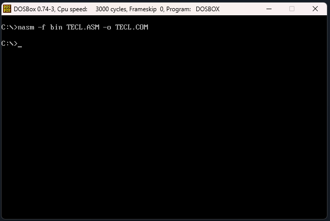
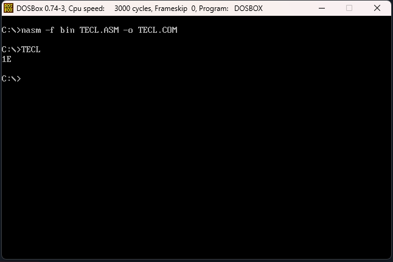
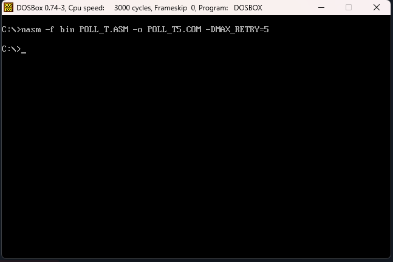
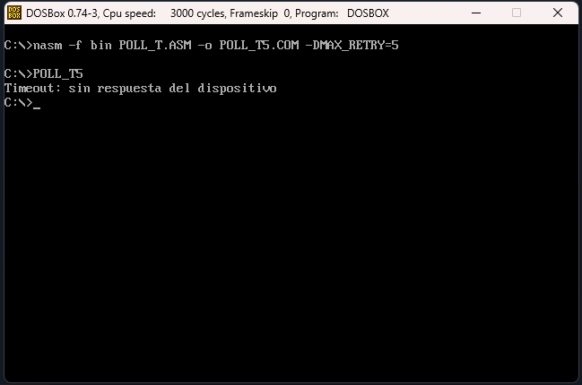
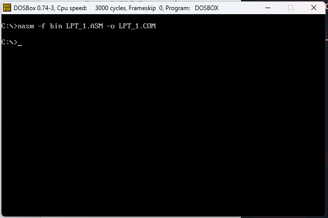
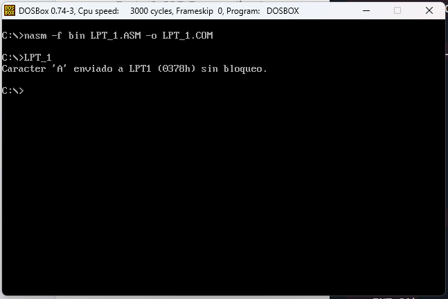
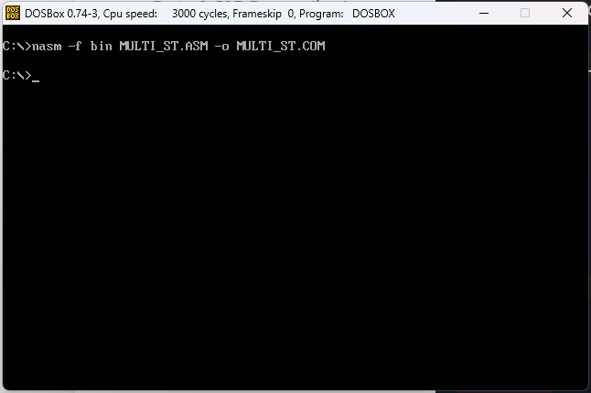
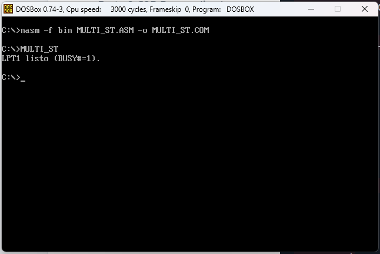
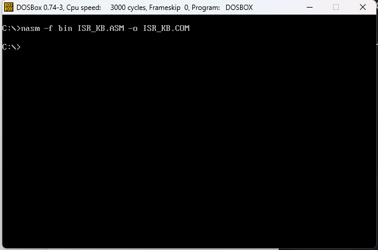
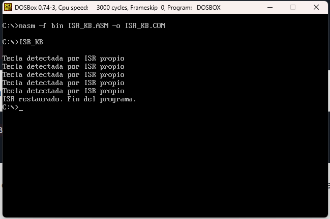
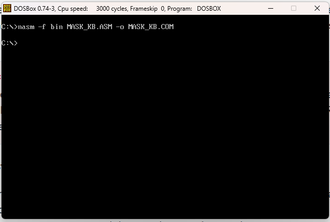
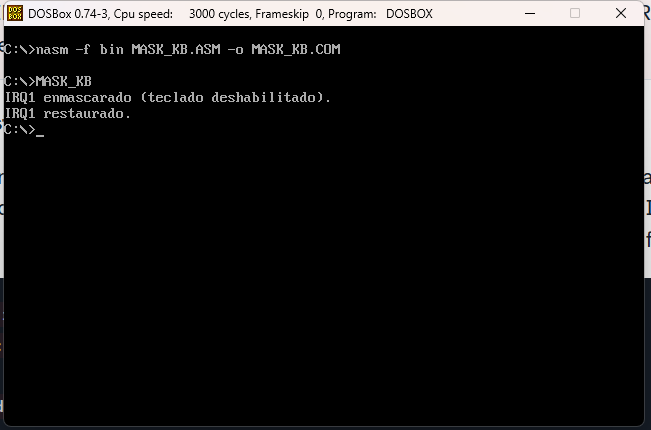
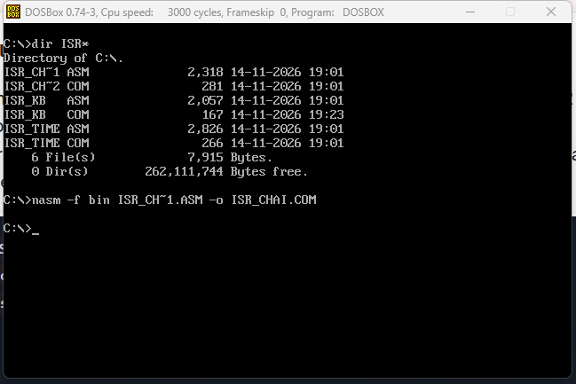
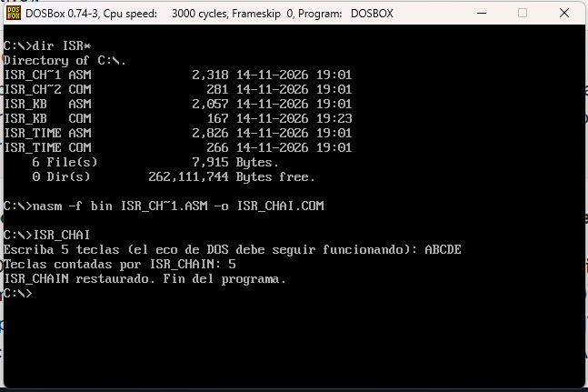
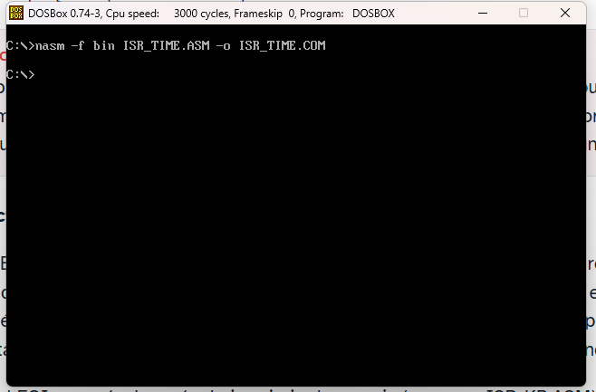
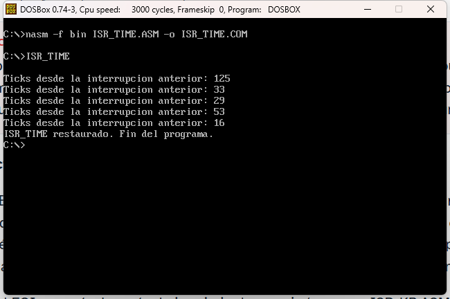

## Riesgo de bloqueo del sistema

Si un ISR no envía el EOI al puerto 20h antes del `IRET`, el PIC deja de atender interrupciones de igual o menor prioridad y el teclado puede dejar de responder. El estudiante verificó que cada versión de ISR envía el EOI antes del `IRET` (o lo delega al handler original en `ISR_CHAIN.ASM`).
